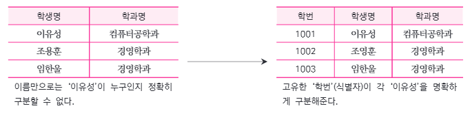
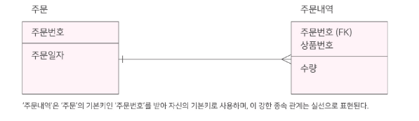
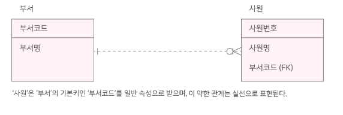

# 1-5. 식별자(Identifier)

## 1. 식별자의 개념

> **식별자(Identifier)** 란 데이터베이스에서 수많은 데이터 중 **특정 인스턴스(행, 레코드)를 유일하게 구분할 수 있는 속성 또는 속성의 집합**이다.

식별자는 각 데이터의 **'이름표'** 역할을 한다.

하나의 엔터티에는 데이터를 유일하게 식별할 수 있는 여러 **후보 식별자**가 존재할 수 있다.

이 중 엔터티를 대표할 **하나의 주식별자**를 선정한다.

### 1.1 식별자가 필요한 이유

학생의 이름만으로 학생을 구분한다고 가정하자.

| 학생명 | 학과명 |
|---|---|
| 이유성 | 컴퓨터공학과 |
| 조용훈 | 경영학과 |
| 임한율 | 경영학과 |

**문제점**

- 학생명이 같은 **동명이인**이 존재할 수 있다.
- 이름만으로는 특정 학생을 유일하게 식별할 수 없다.

따라서 **'학번'** 이라는 고유한 식별자를 추가한다.

| **학번(PK)** | 학생명 | 학과명 |
|---|---|---|
| **1001** | 이유성 | 컴퓨터공학과 |
| **1002** | 조용훈 | 경영학과 |
| **1003** | 임한율 | 경영학과 |

> **핵심:** 식별자는 데이터의 **중복이나 모호함 없이 특정 인스턴스를 구분**하기 위해 사용한다.

### 1.2 주식별자와 보조식별자

| 구분 | **주식별자(Primary Identifier)** | **보조식별자(Alternate Identifier)** |
|---|---|---|
| **의미** | 후보 식별자 중 엔터티를 대표하도록 선정된 식별자 | 주식별자로 선택되지 않은 나머지 후보 식별자 |
| **대표성** | 엔터티를 대표하는 핵심 식별자 | 대표로 선택되지 않은 식별자 |
| **개수** | 엔터티당 하나 | 여러 개 존재 가능 |
| **역할** | 다른 엔터티와 관계를 맺을 때 참조 기준으로 활용 | 데이터를 유일하게 찾는 또 다른 방법 |
| **물리적 구현** | 기본키(PK) | 대체키(Alternate Key), UNIQUE 제약조건 등 |

**예시: 회원 엔터티**

- **'회원번호'**: 주식별자
- **'이메일'**: 보조식별자 (이메일의 유일성이 보장되는 경우)

이메일은 변경될 가능성이 있지만, 시스템에서 부여한 회원번호는 변경될 가능성이 낮으므로 **주식별자로 더 적합**하다.

---

## 2. 식별자의 특징

좋은 **주식별자**는 데이터를 명확하게 구분하고 안정적으로 관리하기 위해 다음 네 가지 특징을 만족해야 한다.

| 특징 | 설명 |
|---|---|
| **유일성** | 모든 인스턴스를 **유일하게 식별**해야 한다. |
| **최소성** | 유일성을 만족하는 **최소한의 속성**으로 구성해야 한다. |
| **불변성** | 식별자의 값은 **가급적 변경되지 않아야 한다.** |
| **존재성** | 주식별자의 값은 **NULL이 될 수 없으며 반드시 존재**해야 한다. |

### 2.1 특징별 예시

**① 유일성(Uniqueness)**

- 학생마다 서로 다른 **'학번'** 을 부여한다.
- 동일한 학번을 가진 학생이 존재해서는 안 된다.

**② 최소성(Minimality)**

- '학번'만으로 학생을 구분할 수 있다면 **'학번 + 학생명'** 을 식별자로 사용할 필요가 없다.
- 불필요한 속성을 포함하지 않아야 한다.

**③ 불변성(Immutability)**

- 학생의 학과나 이름은 변경될 수 있다.
- 반면 **'학번'** 은 한번 부여되면 변경되지 않는 것이 바람직하다.

**④ 존재성(Existence)**

- 주식별자는 반드시 유효한 값을 가져야 한다.
- SQL에서 **PRIMARY KEY** 는 `NULL`을 허용하지 않는다.

> **시험 포인트**
>
> 주식별자의 특징은 **유일성, 최소성, 불변성, 존재성**이다.
>
> 단, **불변성**은 변경이 절대 불가능하다는 뜻이 아니라 **변경되지 않도록 설계하는 것이 바람직하다**는 의미이다.

---

## 3. 식별자의 분류

식별자는 다음 네 가지 기준에 따라 분류한다.

| 분류 기준 | 식별자 종류 |
|---|---|
| **대표성 여부** | 주식별자 / 보조식별자 |
| **스스로 생성 여부** | 내부식별자 / 외부식별자 |
| **속성의 개수** | 단일식별자 / 복합식별자 |
| **대체 여부** | 본질식별자 / 인조식별자 |

### 3.1 대표성 여부

식별자가 엔터티를 **대표하는지**에 따라 분류한다.

| 구분 | 의미 | 예시 |
|---|---|---|
| **주식별자** | 엔터티를 대표하도록 선정된 하나의 핵심 식별자 | '회원번호' |
| **보조식별자** | 대표로 선정되지 않은 나머지 후보 식별자 | '이메일' |

**예시: 회원 엔터티**

- 회원번호: 고유하고 변경 가능성이 낮음 → **주식별자**
- 이메일: 고유하지만 변경 가능성이 있음 → **보조식별자**

### 3.2 스스로 생성 여부

식별자가 **엔터티 내부에서 생성되었는지**, 아니면 **다른 엔터티로부터 받아왔는지**에 따라 분류한다.

| 구분 | 의미 | 예시 |
|---|---|---|
| **내부식별자** | 엔터티 내부에서 자체적으로 생성된 식별자 | '주문' 엔터티의 '주문번호' |
| **외부식별자** | 다른 엔터티와의 관계를 통해 받아온 식별자 | '주문내역' 엔터티의 '주문번호' |

**예시**

- **'주문' 엔터티**는 새로운 주문이 발생할 때 **'주문번호'** 를 직접 생성한다.
- **'주문내역' 엔터티**는 '주문' 엔터티에서 '주문번호'를 전달받아 자신의 식별자 일부로 사용한다.

> **핵심:** 내부식별자는 **자체 생성**, 외부식별자는 **다른 엔터티로부터 상속**받은 식별자이다.

### 3.3 단일 속성 여부

식별자를 구성하는 **속성의 개수**에 따라 분류한다.

| 구분 | 의미 | 예시 |
|---|---|---|
| **단일식별자** | 하나의 속성만으로 인스턴스를 유일하게 구분 | '학생'의 '학번' |
| **복합식별자** | 두 개 이상의 속성을 조합하여 인스턴스를 구분 | '수강신청'의 '학번 + 과목코드' |

**예시: 수강신청 엔터티**

| 학번 | 과목코드 | 수강학기 |
|---|---|---|
| 1001 | CS101 | 2026-1 |
| 1001 | CS102 | 2026-1 |
| 1002 | CS101 | 2026-1 |

한 학기에 동일 과목을 한 번만 신청할 수 있다고 가정하면,

- **'학번'** 만으로는 수강신청 내역을 구분할 수 없다.
- **'과목코드'** 만으로도 구분할 수 없다.
- **'학번 + 과목코드'** 를 조합하면 특정 수강신청 내역을 식별할 수 있다.

따라서 **복합식별자**에 해당한다.

※ 동일 과목의 재수강 기록까지 관리한다면 '수강학기' 등 추가 속성이 식별자에 필요할 수 있다.

### 3.4 대체 여부

업무에서 기존에 사용하던 식별자를 그대로 사용할지, **시스템 전용 식별자를 새로 생성할지**에 따라 분류한다.

| 구분 | 의미 | 예시 |
|---|---|---|
| **본질식별자** | 업무상 원래 사용하던 의미 있는 식별자 | '학과명 + 과목명 + 분반' |
| **인조식별자** | 식별을 위해 시스템에서 인위적으로 만든 식별자 | '강의코드' |

**예시: 강의 엔터티**

**① 본질식별자 사용**

- '컴퓨터공학과 + 자료구조 + 01분반'
- 업무적으로 의미가 있지만 길고 복잡하다.

**② 인조식별자 사용**

- 시스템에서 **'CS101-01'** 과 같은 고유한 강의코드를 부여
- 짧고 단순하며 참조하기 쉽다.

단, 강의코드를 인조식별자로 사용한다면 코드의 **유일성을 보장**해야 한다.

> **시험 포인트**
>
> - **본질식별자:** 업무에서 자연스럽게 존재하는 식별자
> - **인조식별자:** 시스템에서 식별 목적으로 만든 식별자

---

## 4. 식별자 관계와 비식별자 관계

> 부모 엔터티의 **기본키(PK)** 를 자식 엔터티가 **어떤 방식으로 이어받는지**에 따라 관계는 **식별자 관계**와 **비식별자 관계**로 구분된다.

### 4.1 식별자 관계(Identifying Relationship)

> **식별자 관계**란 자식 엔터티가 부모 엔터티의 **기본키(PK)를 자신의 기본키 일부로 포함**하는 관계이다.

**특징**

- 부모 엔터티의 PK가 자식 엔터티의 **PK이자 FK**가 된다.
- 자식 엔터티의 식별이 부모 엔터티의 식별자에 의존한다.
- 부모와 자식 사이의 **강한 식별 종속성**을 나타낸다.
- IE 표기법에서 **실선**으로 표현한다.

**예시: 주문 - 주문내역**

**'주문' 엔터티**

| **주문번호(PK)** | 주문일자 |
|---|---|
| 1001 | 2026-10-28 |
| 1002 | 2026-10-29 |

**'주문내역' 엔터티**

| **주문번호(PK, FK)** | **상품번호(PK)** | 수량 |
|---|---|---|
| 1001 | A001 | 2 |
| 1001 | B001 | 1 |
| 1002 | A001 | 3 |

- '주문내역'은 '주문'의 **'주문번호'** 를 상속받는다.
- 상속받은 주문번호는 **'주문내역'의 기본키 일부**가 된다.
- 따라서 두 엔터티는 **식별자 관계**이다.

> **핵심:** 부모 PK → 자식 **PK + FK**
>
> **ERD 표기: 실선**

### 4.2 비식별자 관계(Non-identifying Relationship)

> **비식별자 관계**란 자식 엔터티가 부모 엔터티의 기본키를 **자신의 기본키에 포함하지 않고 외래키(FK)로만 사용**하는 관계이다.

**특징**

- 부모 엔터티의 PK가 자식 엔터티의 **일반 속성인 FK**로 전달된다.
- 자식 엔터티는 부모 PK 없이도 자신의 PK로 식별할 수 있다.
- 식별자 관계에 비해 **식별 종속성이 약하다.**
- IE 표기법에서 **점선**으로 표현한다.

**예시: 부서 - 사원**

**'부서' 엔터티**

| **부서코드(PK)** | 부서명 |
|---|---|
| D001 | 개발팀 |
| D002 | 영업팀 |

**'사원' 엔터티**

| **사원번호(PK)** | 사원명 | **부서코드(FK)** |
|---|---|---|
| E001 | 홍길동 | D001 |
| E002 | 이영희 | D001 |
| E003 | 김철수 | D002 |

- 사원은 부서의 **'부서코드'** 를 외래키로 참조한다.
- 하지만 사원은 **'사원번호'** 만으로 유일하게 식별할 수 있다.
- 따라서 두 엔터티는 **비식별자 관계**이다.

> **핵심:** 부모 PK → 자식 **일반 속성(FK)**
>
> **ERD 표기: 점선**

**주의:** 비식별자 관계라고 해서 자식 데이터가 반드시 부모 없이 존재할 수 있다는 뜻은 아니다.

부모와의 관계가 필수인지 선택인지는 **관계선택사양(Optionality)** 으로 별도로 결정된다.

### 4.3 식별자 관계와 비식별자 관계 비교

| 구분 | **식별자 관계(Identifying)** | **비식별자 관계(Non-identifying)** |
|---|---|---|
| **핵심** | 부모 PK → 자식 PK의 일부 | 부모 PK → 자식 일반 속성(FK) |
| **자식의 PK** | 부모 PK를 포함 | 부모 PK를 포함하지 않음 |
| **식별 종속성** | 강함 | 약함 |
| **ERD 표기법** | **실선** | **점선** |
| **예시** | 주문 - 주문내역 | 부서 - 사원 |

> **시험 포인트**
>
> 식별자 관계와 비식별자 관계를 구분하는 가장 중요한 기준은 **부모의 기본키가 자식의 기본키에 포함되는지 여부**이다.
>
> - **식별자 관계:** 자식 PK에 포함
> - **비식별자 관계:** 자식 PK에 포함되지 않고 FK로만 사용

---

## 5. 핵심 암기 정리

### 5.1 식별자의 특징

| 특징 | 핵심 키워드 |
|---|---|
| **유일성** | 중복 없이 구분 |
| **최소성** | 최소 속성으로 구성 |
| **불변성** | 변경되지 않는 것이 바람직 |
| **존재성** | NULL 불가 |

### 5.2 식별자의 분류

| 분류 기준 | 구분 |
|---|---|
| **대표성** | 주식별자 / 보조식별자 |
| **생성 위치** | 내부식별자 / 외부식별자 |
| **속성 개수** | 단일식별자 / 복합식별자 |
| **대체 여부** | 본질식별자 / 인조식별자 |

### 5.3 식별자 관계

- **식별자 관계:** 부모 PK가 자식 PK의 일부, **실선**
- **비식별자 관계:** 부모 PK가 자식의 FK로만 사용, **점선**

---

## 6. 셀프 테스트

1. **식별자(Identifier)** 란 무엇인가?
2. **주식별자**와 **보조식별자**의 차이는?
3. 주식별자의 **4가지 특징**은?
4. **내부식별자**와 **외부식별자**의 차이는?
5. **단일식별자**와 **복합식별자**의 차이는?
6. **본질식별자**와 **인조식별자**의 차이는?
7. **식별자 관계**와 **비식별자 관계**의 가장 중요한 구분 기준은?
8. 식별자 관계와 비식별자 관계는 ERD에서 각각 어떤 선으로 표현하는가?
9. 비식별자 관계의 자식 엔터티는 반드시 부모 엔터티 없이 존재할 수 있는가?
