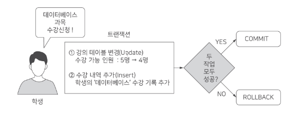

# 2-3. 트랜잭션(Transaction)

## 1. 트랜잭션의 개념

> **트랜잭션(Transaction)** 이란 서로 관련된 여러 작업을 **하나의 논리적인 작업 단위**로 묶어 처리하는 것이다.

트랜잭션은 **'All or Nothing(전부 성공하거나 전부 실패하거나)'** 원칙을 따른다.

- 모든 작업이 성공하면 **COMMIT**을 통해 변경 사항을 확정한다.
- 작업 중 문제가 발생하면 **ROLLBACK**을 통해 전체 변경 사항을 취소한다.

### 1.1 트랜잭션의 예시

**예시: 수강신청 시스템**

학생이 강의를 수강신청하는 업무는 다음 두 작업으로 구성될 수 있다.

1. **UPDATE:** 해당 강의의 수강 가능 인원을 1명 감소
2. **INSERT:** 학생의 수강신청 내역 추가

두 작업은 반드시 **하나의 트랜잭션**으로 묶여야 한다.

| 상황 | 처리 결과 |
|---|---|
| **두 작업 모두 성공** | COMMIT → 변경 사항 확정 |
| **하나라도 실패** | ROLLBACK → 전체 변경 사항 취소 |

> **핵심:** 두 작업이 모두 성공해야 최종 반영되며, 하나라도 실패하면 전체 작업을 취소해야 한다.

---

## 2. 트랜잭션의 특징(ACID)

트랜잭션은 **ACID**라고 불리는 네 가지 특징을 가진다.

### 2.1 원자성(Atomicity)

> 트랜잭션에 포함된 모든 작업은 **전부 성공하거나 전부 취소**되어야 한다.

- **All or Nothing** 원칙
- 하나라도 실패하면 전체 작업을 **ROLLBACK**

### 2.2 일관성(Consistency)

> 트랜잭션이 성공적으로 완료된 후에도 데이터베이스는 **일관된 상태와 무결성**을 유지해야 한다.

**예시:** 수강신청이 완료된 후에도 실제 신청 인원이 **수강 정원을 초과하지 않아야 한다.**

### 2.3 고립성(Isolation)

> 여러 트랜잭션이 동시에 실행될 때 서로 **부적절하게 간섭하지 않도록** 보장하는 특성이다.

- 각 트랜잭션이 독립적으로 실행되는 것과 같은 결과를 지향
- 실제 간섭 허용 범위는 **트랜잭션 격리 수준**에 따라 달라짐

### 2.4 지속성(Durability)

> 성공적으로 완료된 트랜잭션의 결과는 **영구적으로 보존**되어야 한다.

- **COMMIT**된 결과는 시스템 장애 발생 후에도 유지되어야 한다.

---

## 3. 핵심 암기 정리

| 특성 | 핵심 키워드 |
|---|---|
| **원자성(Atomicity)** | All or Nothing |
| **일관성(Consistency)** | 데이터 무결성 유지 |
| **고립성(Isolation)** | 트랜잭션 간 간섭 제어 |
| **지속성(Durability)** | COMMIT 결과 영구 보존 |
