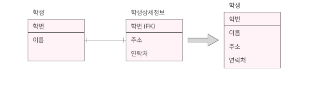
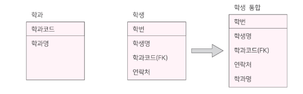
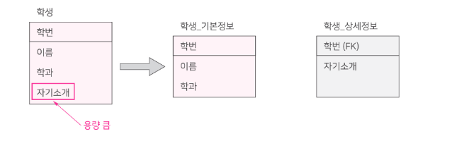
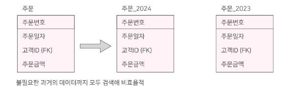
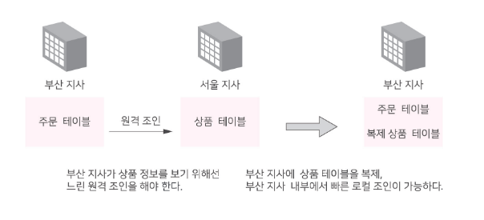
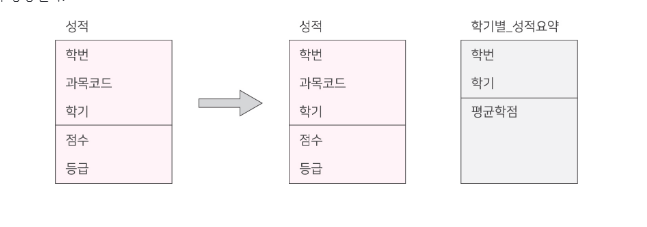
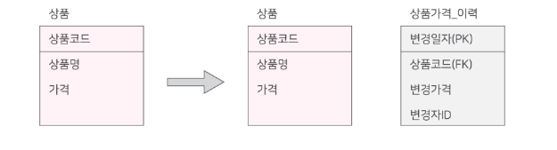
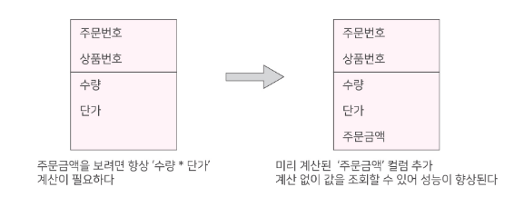
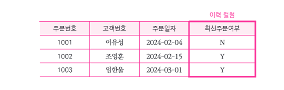
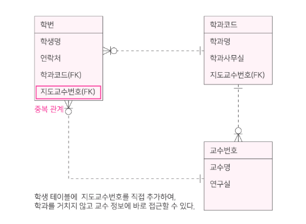

# 2-2. 반정규화(De-normalization)

## 1. 반정규화의 개념

> **반정규화(De-normalization)** 란 **조회 성능을 향상**시키기 위해 정규화된 데이터 모델에 **중복을 허용하거나 테이블·컬럼·관계 구조를 의도적으로 변경**하는 과정이다.

정규화 과정에서 테이블이 분리되면 데이터의 **일관성과 정확성**은 높아지지만, 여러 테이블을 조회하기 위한 **JOIN 연산이 증가**할 수 있다.

반정규화는 이러한 성능 저하를 개선하기 위해 사용한다.

- **JOIN 감소:** 자주 함께 사용하는 데이터를 미리 결합
- **계산 비용 감소:** 반복적으로 계산하는 결과를 미리 저장
- **조회 범위 축소:** 대량의 데이터를 효율적으로 조회
- **데이터 접근 경로 단축:** 복잡한 관계를 단순화

### 1.1 정규화와 반정규화 비교

| 구분 | 정규화 | 반정규화 |
|---|---|---|
| **목적** | 데이터 중복 최소화 | 조회 성능 향상 |
| **데이터 중복** | 감소 | 증가할 수 있음 |
| **데이터 무결성** | 유지하기 유리 | 별도 관리 필요 |
| **JOIN 연산** | 증가할 수 있음 | 감소 가능 |
| **조회 성능** | 쿼리에 따라 다름 | 특정 조회 개선 가능 |
| **관리 비용** | 중복 관리 부담 감소 | 동기화 및 갱신 부담 증가 |

> **핵심:** 정규화는 **데이터의 일관성과 정확성**, 반정규화는 **조회 성능**에 중점을 둔다.
>
> 다만 반정규화가 반드시 무결성을 훼손하는 것은 아니며, **중복 데이터의 일관성을 유지할 수 있는 관리 방안**이 필요하다.

### 1.2 반정규화 적용 시 고려사항

반정규화를 적용하기 전에 다음 사항을 검토해야 한다.

1. **조회 성능 저하 여부**를 확인한다.
2. 인덱스, SQL 튜닝, 파티셔닝 등 **다른 성능 개선 방법**을 검토한다.
3. 반정규화 적용에 따른 **데이터 중복 및 갱신 비용**을 분석한다.
4. 성능 개선 효과가 충분한 경우 **반정규화를 적용**한다.

### 1.3 반정규화의 분류

| 분류 | 주요 기법 |
|---|---|
| **테이블 반정규화** | 테이블 병합, 분할, 추가 |
| **컬럼 반정규화** | 중복 컬럼, 파생 컬럼, 이력 관련 컬럼 추가 |
| **관계 반정규화** | 중복 관계 추가 |

---

## 2. 테이블 반정규화

> **테이블 반정규화**란 조회 성능을 향상시키기 위해 기존 테이블을 **병합하거나 분할하고, 필요한 테이블을 추가**하는 기법이다.

테이블 반정규화는 크게 다음 세 가지로 구분한다.

1. **테이블 병합**
2. **테이블 분할**
3. **테이블 추가**

### 2.1 테이블 병합

> **테이블 병합**이란 자주 JOIN이 발생하는 관계의 테이블을 **하나의 테이블로 통합**하여 조회 성능을 높이는 기법이다.

#### ① 1:1 관계 테이블 병합

서로 **1:1 관계**인 두 테이블을 하나로 합치는 방법이다.

**예시: 학생 - 학생상세정보**

기존 구조

- **학생:** 학번(PK), 이름
- **학생상세정보:** 학번(PK, FK), 주소, 연락처

두 테이블을 자주 함께 조회한다면 하나의 **'학생' 테이블**로 통합할 수 있다.

병합 후

- **학생:** 학번(PK), 이름, 주소, 연락처

**장점**

- 두 테이블 사이의 **JOIN 제거**
- 함께 조회하는 데이터의 접근 속도 향상

**단점**

- 사용하지 않는 속성까지 테이블에 포함될 수 있음
- NULL이 많은 속성이 있다면 저장 공간이 비효율적일 수 있음

#### ② 1:M 관계 테이블 병합

**1:N 관계**인 두 테이블을 하나로 합치는 방법이다.

**예시: 학과 - 학생**

기존 구조

- **학과:** 학과코드(PK), 학과명
- **학생:** 학번(PK), 학생명, 학과코드(FK), 연락처

두 테이블을 병합하면 학생 테이블에 **'학과명'** 등의 정보를 함께 저장하게 된다.

**장점**

- 자주 사용하는 학과 정보를 JOIN 없이 조회 가능
- 특정 조회의 성능 향상

**단점**

- 같은 학과에 속한 여러 학생에게 **학과 정보가 중복 저장**
- 학과명 변경 시 여러 행을 수정해야 함
- **갱신 이상(Update Anomaly)** 발생 가능

> **시험 포인트**
>
> - **1:1 병합:** 자주 발생하는 JOIN을 제거
> - **1:N 병합:** JOIN을 줄일 수 있지만 **1쪽 데이터의 중복**이 증가
>
> 특히 **1:N 관계의 테이블 병합은 데이터 중복과 갱신 비용**에 주의해야 한다.

---

### 2.2 테이블 분할

> **테이블 분할**이란 하나의 테이블을 데이터 접근 특성에 따라 **두 개 이상의 테이블 또는 저장 영역으로 나누는 기법**이다.

분할 기준에 따라 **수직 분할**과 **수평 분할**로 구분한다.

#### ① 수직 분할(Vertical Partitioning)

> **수직 분할**은 하나의 테이블을 **속성(Column)** 기준으로 나누는 방법이다.

**예시: 학생 테이블**

기존 구조

- **학생:** 학번, 이름, 학과, 자기소개

이때 **'자기소개'** 는 데이터 크기가 크고 조회 빈도가 낮다고 가정한다.

분할 후

- **학생_기본정보:** 학번(PK), 이름, 학과
- **학생_상세정보:** 학번(PK, FK), 자기소개

**효과**

- 자주 조회하는 속성만 별도로 관리
- 한 번에 읽어야 할 데이터량 감소
- 불필요한 디스크 I/O 감소 가능

> **핵심:** 수직 분할은 **열(Column)을 기준**으로 나눈다.

#### ② 수평 분할(Horizontal Partitioning)

> **수평 분할**은 하나의 테이블을 **인스턴스(Row)** 기준으로 나누는 방법이다.

**예시: 주문 테이블**

기존 구조

- **주문:** 주문번호, 주문일자, 고객ID, 주문금액

주문 데이터가 지나치게 많아지면 조회 성능이 저하될 수 있다.

이를 **주문 연도**에 따라 분리한다.

- **주문_2023:** 2023년 주문 데이터
- **주문_2024:** 2024년 주문 데이터

**효과**

- 조회해야 할 데이터 범위 감소
- 대량 데이터 처리 효율 향상
- 연도별 데이터 관리 용이

> **핵심:** 수평 분할은 **행(Row)을 기준**으로 나눈다.

#### ③ 수평 분할과 파티셔닝의 차이

| 구분 | 수평 분할 | 파티셔닝(Partitioning) |
|---|---|---|
| **개념** | 데이터를 행 기준으로 나누는 설계 방식 | 데이터를 물리적으로 분할·관리하는 기술 |
| **기준** | 날짜, 지역, 범위 등 | RANGE, LIST, HASH 등 |
| **구현** | 별도 테이블 구성 등의 방식 | DBMS의 파티션 기능 활용 |

> **시험 포인트**
>
> - **수직 분할:** Column 기준
> - **수평 분할:** Row 기준
> - **파티셔닝:** 수평 분할 등을 DBMS에서 구현하는 대표적인 기술
>
> 수평 분할이 반드시 별도의 테이블 여러 개를 만드는 방식으로 구현되는 것은 아니다.

---

### 2.3 테이블 추가

> **테이블 추가**란 기존 테이블을 유지하면서 **특정 조회를 빠르게 처리하기 위한 새로운 테이블**을 추가하는 반정규화 기법이다.

대표적으로 다음 네 가지 방법이 있다.

1. **중복 테이블 추가**
2. **통계 테이블 추가**
3. **이력 테이블 추가**
4. **부분 테이블 추가**

#### ① 중복 테이블 추가

> **중복 테이블 추가**란 다른 서버나 업무에서 사용되는 테이블을 **복제하여 별도로 저장**하는 방법이다.

**예시: 지사별 상품 조회**

- 부산 지사에는 **주문 테이블**이 존재
- 서울 지사에는 **상품 테이블**이 존재

부산 지사에서 상품 정보를 조회하려면 원격으로 서울 지사의 상품 테이블에 접근해야 한다.

상품 테이블을 부산 지사에도 복제하면 **원격 JOIN이나 네트워크 접근 비용**을 줄일 수 있다.

**장점**

- 원격 데이터 접근 감소
- 조회 성능 향상
- 서버 간 네트워크 부하 감소 가능

**단점**

- 중복 데이터 저장 공간 필요
- 원본과 복제본 사이의 **동기화 문제** 발생 가능

#### ② 통계 테이블 추가

> **통계 테이블 추가**란 자주 사용하는 **합계, 평균, 건수 등의 통계 결과**를 미리 계산하여 별도의 테이블에 저장하는 방법이다.

**예시: 학생 성적 관리**

기존에는 학생의 학기별 평균학점을 조회할 때마다 성적 테이블 전체에서 평균을 계산해야 한다.

이를 개선하기 위해 **'학기별_성적요약'** 테이블을 추가한다.

**성적 테이블**

| 학번 | 과목코드 | 학기 | 점수 |
|---|---|---|---|
| 1001 | CS101 | 1 | 90 |
| 1001 | CS102 | 1 | 80 |
| 1002 | CS101 | 1 | 95 |

**학기별_성적요약 테이블**

| 학번 | 학기 | 평균점수 |
|---|---|---|
| 1001 | 1 | 85 |
| 1002 | 1 | 95 |

**효과**

- 반복적인 집계 연산 감소
- 통계 조회 성능 향상
- 대량 데이터 조회 부담 감소

> **주의:** 원본 성적 데이터가 변경되면 **요약 테이블의 집계 결과도 갱신**해야 한다.

#### ③ 이력 테이블 추가

> **이력 테이블 추가**란 원본 데이터의 **변경 내역을 관리하거나 이력 조회를 효율화**하기 위해 별도의 테이블을 추가하는 방법이다.

**예시: 상품 가격 변경 이력**

기존 구조

- **상품:** 상품코드, 상품명, 가격

변경 이력을 관리하기 위해 별도의 테이블을 추가한다.

- **상품:** 상품코드, 상품명, 현재가격
- **상품가격_이력:** 변경일자(PK), 상품코드(FK), 변경가격, 변경자ID

※ 실제 설계에서는 변경일자만으로 유일성이 보장되지 않을 수 있으므로 별도의 이력번호를 PK로 사용하기도 한다.

**효과**

- 데이터 변경 이력 조회 가능
- 현재 데이터와 과거 데이터의 관리 분리
- 특정 이력 조회의 성능 개선 가능

> **참고:** 단순히 변경 이력을 보존하는 것은 일반적인 이력 관리 설계이기도 하다. SQLD의 반정규화에서는 **성능 향상을 위해 이력 데이터를 중복·추가로 관리하는 경우**를 함께 이해한다.

#### ④ 부분 테이블 추가

> **부분 테이블 추가**란 하나의 테이블에서 **자주 조회하는 일부 속성만 복제하여 별도의 테이블을 추가**하는 방법이다.

**예시: 상품 테이블**

기존 테이블

| 상품코드(PK) | 상품명 | 가격 | 상품상세설명 |
|---|---|---|---|
| P001 | 노트북 | 1200000 | 고성능 노트북 |
| P002 | 모니터 | 300000 | QHD 모니터 |

상품 목록 화면에서는 **'상품코드', '상품명', '가격'** 만 자주 사용한다고 가정한다.

이 경우 해당 속성만 복제한 **'상품_목록조회'** 테이블을 추가할 수 있다.

| 상품코드(PK) | 상품명 | 가격 |
|---|---|---|
| P001 | 노트북 | 1200000 |
| P002 | 모니터 | 300000 |

**효과**

- 자주 사용하는 데이터만 빠르게 조회
- 불필요한 데이터 읽기 감소
- 대용량 속성 접근 최소화

> **수직 분할과의 차이**
>
> - **수직 분할:** 기존 테이블의 속성을 나누어 관리
> - **부분 테이블 추가:** 기존 테이블을 유지하면서 일부 속성을 **복제한 테이블 추가**
>
> 두 방법 모두 자주 사용하는 속성에 대한 접근을 효율화한다.

---

## 3. 컬럼 반정규화

> **컬럼 반정규화**란 테이블의 기본 구조를 유지하면서 **조회 성능 향상을 위해 새로운 컬럼을 추가하거나 중복된 값을 저장**하는 기법이다.

대표적인 방법은 다음과 같다.

1. **중복 컬럼 추가**
2. **파생 컬럼 추가**
3. **이력 테이블 컬럼 추가**

### 3.1 중복 컬럼 추가

> **중복 컬럼 추가**란 자주 조회하는 다른 테이블의 속성을 현재 테이블에 **중복하여 저장**하는 방법이다.

**예시: 학생 - 학과**

기존 구조

- **학생:** 학번(PK), 학생명, 학과코드(FK)
- **학과:** 학과코드(PK), 학과명

학생의 학과명을 조회하려면 항상 학과 테이블과 JOIN해야 한다.

이를 개선하기 위해 학생 테이블에 **'학과명' 컬럼을 중복 추가**한다.

**장점**

- 불필요한 JOIN 감소
- 자주 조회하는 데이터의 조회 성능 향상

**단점**

- 학과명이 여러 학생 데이터에 중복 저장
- 학과명 변경 시 **중복된 모든 데이터의 일관성 유지 필요**

> **시험 포인트:** 중복 컬럼 추가의 핵심 목적은 **JOIN 감소**이다.

### 3.2 파생 컬럼 추가

> **파생 컬럼 추가**란 다른 속성으로부터 계산할 수 있는 값을 **미리 계산하여 별도의 컬럼에 저장**하는 방법이다.

**예시: 주문내역**

기존 구조

- **주문내역:** 주문번호, 상품번호, 수량, 단가

주문금액을 조회할 때마다 다음 계산이 필요하다.

`주문금액 = 수량 × 단가`

이를 개선하기 위해 **'주문금액' 컬럼을 미리 추가**한다.

**장점**

- 반복 계산 감소
- 조회 성능 향상

**단점**

- 수량이나 단가가 변경되면 주문금액도 갱신해야 함
- 계산 결과와 원본 데이터 사이의 **불일치 가능성**

> **시험 포인트**
>
> - **중복 컬럼 추가:** 다른 테이블의 값을 미리 저장하여 JOIN 감소
> - **파생 컬럼 추가:** 계산 결과를 미리 저장하여 계산 비용 감소

### 3.3 이력 테이블 컬럼 추가

> **이력 테이블 컬럼 추가**란 대량의 이력 데이터를 조회할 때 자주 필요한 **최근 값 여부, 시작일자, 종료일자** 등의 기능성 컬럼을 추가하는 방법이다.

**예시: 주문 이력**

기존 주문 테이블에 **'최신주문여부'** 컬럼을 추가한다고 가정한다.

| 주문번호 | 고객번호 | 주문일자 | 최신주문여부 |
|---|---|---|---|
| 1001 | C001 | 2024-02-04 | N |
| 1002 | C002 | 2024-02-15 | Y |
| 1003 | C001 | 2024-03-01 | Y |

고객별 최신 주문을 조회할 때 매번 최대 주문일자를 계산하는 대신 **'최신주문여부'** 를 활용할 수 있다.

**효과**

- 최신 이력 조회 성능 향상
- 특정 시점의 데이터 검색 효율 개선
- 불필요한 정렬 및 집계 연산 감소 가능

> **주의:** 새로운 주문이 발생하면 이전 주문의 최신 여부도 변경해야 하므로 **추가적인 갱신 작업**이 필요하다.

### 3.4 컬럼 반정규화 비교

| 구분 | 목적 | 예시 |
|---|---|---|
| **중복 컬럼 추가** | JOIN 감소 | 학생 테이블에 학과명 추가 |
| **파생 컬럼 추가** | 계산 비용 감소 | 수량 × 단가 = 주문금액 |
| **이력 컬럼 추가** | 이력 검색 효율 향상 | 최신주문여부, 시작일자 |

---

## 4. 관계 반정규화

> **관계 반정규화**란 여러 엔터티를 거쳐야 하는 **JOIN 경로를 단축**하기 위해 기존 데이터 모델에 **중복된 관계를 추가**하는 기법이다.

대표적인 방법은 **중복 관계 추가**이다.

### 4.1 중복 관계 추가

**예시: 학생 - 학과 - 교수**

기존 관계

- 학생은 **학과**에 소속된다.
- 학과에는 **지도교수**가 배정된다.
- 학생의 지도교수 정보를 조회하려면 **학과를 거쳐 교수 엔터티에 접근**해야 한다.

이를 개선하기 위해 학생 엔터티에서 **교수 엔터티로 직접 연결되는 관계**를 추가한다.

**효과**

- 여러 단계를 거치는 JOIN 경로 단축
- 복잡한 관계를 통한 조회 성능 향상

**주의사항**

- 중복 관계가 기존 관계와 **모순되지 않도록 관리**해야 한다.
- 직접 관계를 구현할 때는 **외래키 중복 저장 및 무결성 문제**도 고려해야 한다.

> **핵심:** 관계 반정규화는 **JOIN 경로를 단축**하는 것이 목적이다.
>
> 테이블 전체를 합치거나 조회용 컬럼을 추가하는 방법과 구별해야 한다.

---

## 5. 반정규화 기법 전체 비교

| 분류 | 세부 기법 | 주요 목적 |
|---|---|---|
| **테이블 병합** | 1:1 병합 | JOIN 제거 |
| | 1:N 병합 | JOIN 감소 |
| **테이블 분할** | 수직 분할 | 컬럼별 접근 효율 향상 |
| | 수평 분할 | 행별 조회 범위 축소 |
| **테이블 추가** | 중복 테이블 | 원격 접근 및 JOIN 감소 |
| | 통계 테이블 | 집계 연산 감소 |
| | 이력 테이블 | 이력 관리 및 조회 효율 향상 |
| | 부분 테이블 | 자주 조회하는 속성만 별도 관리 |
| **컬럼 반정규화** | 중복 컬럼 | JOIN 감소 |
| | 파생 컬럼 | 반복 계산 감소 |
| | 이력 컬럼 | 이력 검색 효율 향상 |
| **관계 반정규화** | 중복 관계 | JOIN 경로 단축 |

---

## 6. 핵심 암기 정리

### 6.1 반정규화의 목적

- **조회 성능 향상**
- **JOIN 감소**
- **반복 계산 감소**
- **대량 데이터 접근 효율 개선**

### 6.2 테이블 반정규화

- **병합:** 여러 테이블을 하나로 합침
- **수직 분할:** **열(Column)** 기준 분리
- **수평 분할:** **행(Row)** 기준 분리
- **중복 테이블 추가:** 원격 접근 감소
- **통계 테이블 추가:** 집계 결과 미리 저장
- **이력 테이블 추가:** 이력 데이터 별도 관리
- **부분 테이블 추가:** 자주 사용하는 속성만 복제하여 별도 관리

### 6.3 컬럼 반정규화

- **중복 컬럼:** JOIN 감소
- **파생 컬럼:** 계산 비용 감소
- **이력 컬럼:** 이력 조회 최적화

### 6.4 관계 반정규화

- **중복 관계 추가:** JOIN 경로 단축

> **최종 암기**
>
> **테이블 반정규화 = 병합 / 분할 / 추가**
>
> **컬럼 반정규화 = 중복 / 파생 / 이력**
>
> **관계 반정규화 = 중복 관계 추가**

---

## 7. 셀프 테스트

1. **반정규화(De-normalization)** 의 목적은 무엇인가?
2. 정규화와 반정규화의 차이는?
3. **1:1 테이블 병합**과 **1:N 테이블 병합**의 차이는?
4. **수직 분할**과 **수평 분할**의 차이는?
5. **수평 분할**과 **파티셔닝**은 어떤 관계인가?
6. **중복 테이블 추가**와 **부분 테이블 추가**의 차이는?
7. **통계 테이블 추가**의 목적은?
8. **중복 컬럼 추가**와 **파생 컬럼 추가**의 차이는?
9. **이력 테이블 컬럼 추가**는 어떤 상황에서 활용하는가?
10. **관계 반정규화**를 적용하는 목적은?
11. 반정규화 적용 시 **데이터 무결성**에 주의해야 하는 이유는?
