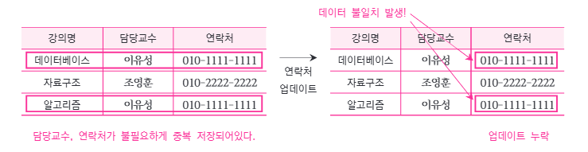
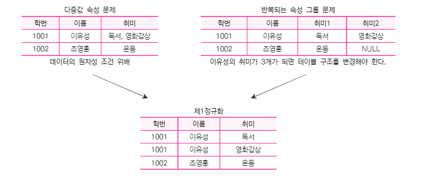
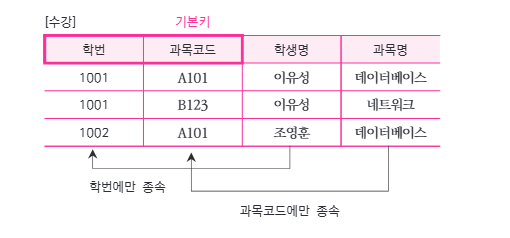
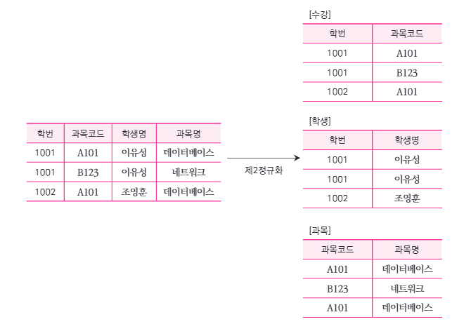
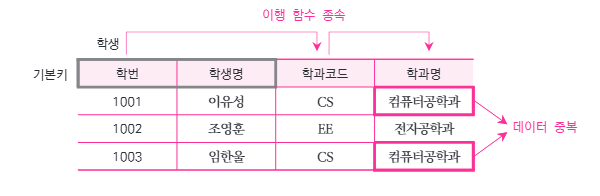
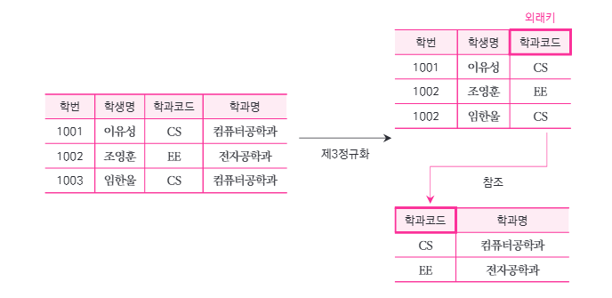

# 2-1. 정규화(Normalization)

## 1. 정규화의 개념

> **정규화(Normalization)** 란 데이터의 **중복을 최소화**하고, 데이터의 **정확성과 일관성**을 유지하기 위해 테이블 구조를 체계적으로 분리하는 과정이다.

정규화의 핵심 목적은 **이상 현상(Anomaly)을 방지**하는 것이다.

- **데이터 중복 최소화:** 동일한 정보가 불필요하게 반복되는 것을 방지
- **데이터 무결성 유지:** 데이터의 정확성과 일관성을 유지
- **이상 현상 방지:** 삽입, 수정, 삭제 과정에서 발생하는 문제를 예방

### 1.1 정규화의 장단점

| 구분 | 설명 |
|---|---|
| **장점** | 데이터 중복 감소, 무결성 향상, 이상 현상 방지 |
| **단점** | 테이블 분리로 인한 JOIN 증가 및 일부 조회 성능 저하 가능 |

> **핵심:** 정규화는 **데이터의 정확성과 일관성**을 우선하지만, 실제 시스템에서는 **조회 성능**도 고려해야 한다.
>
> 필요에 따라 성능 개선을 위한 **반정규화(비정규화)** 를 적용할 수 있다.

### 1.2 이상 현상(Anomaly)

데이터가 불필요하게 중복되면 다음과 같은 문제가 발생할 수 있다.

| 이상 현상 | 설명 |
|---|---|
| **삽입 이상(Insertion Anomaly)** | 불필요한 다른 데이터가 없으면 원하는 데이터를 삽입할 수 없는 문제 |
| **갱신 이상(Update Anomaly)** | 중복된 데이터 중 일부만 수정하여 데이터가 불일치하는 문제 |
| **삭제 이상(Deletion Anomaly)** | 특정 데이터를 삭제하면서 유지해야 할 다른 정보까지 사라지는 문제 |

**갱신 이상 예시**

| 강의명 | 담당교수 | 연락처 |
|---|---|---|
| 데이터베이스 | 이유성 | 010-1111-1111 |
| 자료구조 | 조영훈 | 010-2222-2222 |
| 알고리즘 | 이유성 | 010-1111-1111 |

'이유성' 교수의 연락처가 변경되면 해당 교수의 모든 행을 수정해야 한다.

일부 행만 수정하면 **동일 교수의 연락처가 서로 달라지는 데이터 불일치**가 발생한다.

---

## 2. 제1정규형(1NF: First Normal Form)

> **제1정규형(1NF)** 이란 테이블의 모든 속성값이 **원자값(Atomic Value)** 을 가지는 상태이다.

원자값이란 해당 데이터 모델에서 **더 이상 분해하지 않는 하나의 값**을 의미한다.

제1정규형에서는 다음과 같은 구조를 허용하지 않는다.

1. **다중값 속성:** 하나의 속성에 여러 값을 함께 저장하는 경우
2. **반복되는 속성 그룹:** 동일한 종류의 속성을 여러 개 반복해서 생성하는 경우

### 2.1 다중값 속성 문제

**정규화 이전**

| 학번 | 이름 | 취미 |
|---|---|---|
| 1001 | 이유성 | 독서, 영화감상 |
| 1002 | 조영훈 | 운동 |

'이유성'의 취미 속성에 **'독서, 영화감상'** 이라는 여러 값이 함께 들어 있다.

**제1정규형 적용 후**

| 학번 | 이름 | 취미 |
|---|---|---|
| 1001 | 이유성 | 독서 |
| 1001 | 이유성 | 영화감상 |
| 1002 | 조영훈 | 운동 |

하나의 속성값에는 **하나의 값만 저장**하도록 행을 분리한다.

### 2.2 반복되는 속성 그룹 문제

**정규화 이전**

| 학번 | 이름 | 취미1 | 취미2 |
|---|---|---|---|
| 1001 | 이유성 | 독서 | 영화감상 |
| 1002 | 조영훈 | 운동 | NULL |

- 동일한 의미의 속성인 **'취미1', '취미2'** 가 반복된다.
- 취미가 세 개 이상으로 늘어나면 테이블 구조를 변경해야 한다.

**해결 방법**

반복 속성을 하나의 **'취미'** 속성으로 통합하고 여러 행으로 표현한다.

> **시험 포인트**
>
> 제1정규형의 핵심은 **속성값의 원자성**이다.
>
> 다중값 속성과 반복 속성 그룹을 제거하여 **하나의 칸에 하나의 값**이 저장되도록 한다.

---

## 3. 제2정규형(2NF: Second Normal Form)

> **제2정규형(2NF)** 이란 **제1정규형을 만족**하면서 **부분 함수 종속(Partial Functional Dependency)** 이 없는 상태이다.

부분 함수 종속은 **복합 식별자(복합키)** 를 사용하는 테이블에서 주로 문제가 된다.

### 3.1 부분 함수 종속

> **부분 함수 종속**이란 일반 속성이 **복합키 전체가 아닌 일부 속성에만 종속되는 관계**이다.

**예시: 수강 엔터티**

| **학번(PK)** | **과목코드(PK)** | 학생명 | 과목명 |
|---|---|---|---|
| 1001 | A101 | 이유성 | 데이터베이스 |
| 1001 | B123 | 이유성 | 네트워크 |
| 1002 | A101 | 조영훈 | 데이터베이스 |

기본키는 **'학번 + 과목코드'** 라는 복합키이다.

그런데 일반 속성들의 종속 관계를 살펴보면 다음과 같다.

- **학번 → 학생명**
- **과목코드 → 과목명**

즉, **'학생명'** 은 '학번'에만 종속되고, **'과목명'** 은 '과목코드'에만 종속된다.

이처럼 복합키의 **일부분에만 종속**되는 것이 부분 함수 종속이다.

### 3.2 제2정규형 적용

부분 함수 종속을 제거하기 위해 **'수강', '학생', '과목'** 엔터티를 분리한다.

**① 수강 테이블**

| **학번(PK, FK)** | **과목코드(PK, FK)** |
|---|---|
| 1001 | A101 |
| 1001 | B123 |
| 1002 | A101 |

**② 학생 테이블**

| **학번(PK)** | 학생명 |
|---|---|
| 1001 | 이유성 |
| 1002 | 조영훈 |

**③ 과목 테이블**

| **과목코드(PK)** | 과목명 |
|---|---|
| A101 | 데이터베이스 |
| B123 | 네트워크 |

정규화를 통해 다음과 같은 효과를 얻을 수 있다.

- 학생명이 여러 수강 데이터에 반복 저장되지 않는다.
- 과목명이 여러 수강 데이터에 반복 저장되지 않는다.
- 학생 정보와 과목 정보를 독립적으로 관리할 수 있다.

> **시험 포인트**
>
> 제2정규형의 핵심은 **부분 함수 종속 제거**이다.
>
> **복합키 전체에 종속되지 않는 일반 속성**을 별도 테이블로 분리한다.
>
> 기본키가 단일 속성인 경우에는 해당 기본키에 대한 부분 함수 종속이 발생하지 않는다.

---

## 4. 제3정규형(3NF: Third Normal Form)

> **제3정규형(3NF)** 이란 **제2정규형을 만족**하면서 일반 속성의 **이행 함수 종속(Transitive Functional Dependency)** 을 제거한 상태이다.

핵심은 **식별자가 아닌 일반 속성을 통해 다른 일반 속성이 결정되는 종속 관계**를 제거하는 것이다.

### 4.1 이행 함수 종속

> **이행 함수 종속**이란 식별자와 다른 속성 사이에 중간 속성이 존재하여 **간접적인 종속 관계**가 형성되는 것이다.

예를 들어 다음과 같은 테이블을 생각해 보자.

| **학번(PK)** | 학생명 | 학과코드 | 학과명 |
|---|---|---|---|
| 1001 | 이유성 | CS | 컴퓨터공학과 |
| 1002 | 조영훈 | EE | 전자공학과 |
| 1003 | 임한율 | CS | 컴퓨터공학과 |

이 테이블에서는 다음과 같은 종속 관계가 존재한다.

- **학번 → 학과코드**
- **학과코드 → 학과명**
- 따라서 **학번 → 학과명**

즉, **'학과명'** 은 '학번'에 직접적으로만 의존하는 것이 아니라 **'학과코드'를 거쳐 간접적으로 결정**된다.

**문제점**

- '컴퓨터공학과'라는 데이터가 여러 행에 반복 저장된다.
- 학과명이 변경되면 관련된 모든 학생 데이터를 수정해야 한다.
- 일부만 수정하면 **갱신 이상**이 발생할 수 있다.

### 4.2 제3정규형 적용

이행 함수 종속을 제거하기 위해 **'학생'** 과 **'학과'** 엔터티를 분리한다.

**① 학생 테이블**

| **학번(PK)** | 학생명 | 학과코드(FK) |
|---|---|---|
| 1001 | 이유성 | CS |
| 1002 | 조영훈 | EE |
| 1003 | 임한율 | CS |

**② 학과 테이블**

| **학과코드(PK)** | 학과명 |
|---|---|
| CS | 컴퓨터공학과 |
| EE | 전자공학과 |

정규화를 통해 다음과 같은 효과를 얻을 수 있다.

- 학과명을 **학과 테이블에서 한 번만 관리**한다.
- 학과명이 변경되더라도 학생 테이블을 수정할 필요가 없다.
- 중복된 데이터가 감소하고 데이터의 일관성이 향상된다.

> **시험 포인트**
>
> 제3정규형의 핵심은 **이행 함수 종속 제거**이다.
>
> 일반 속성이 다른 일반 속성을 결정하는 구조를 분리하여 **비식별 속성 간 불필요한 종속 관계**를 제거한다.

---

## 5. 제1~3정규형 비교

| 정규형 | 핵심 조건 | 제거 대상 |
|---|---|---|
| **제1정규형(1NF)** | 모든 속성값의 원자성 | 다중값, 반복 속성 그룹 |
| **제2정규형(2NF)** | 1NF 만족 + 부분 함수 종속 제거 | 복합키 일부에만 종속되는 속성 |
| **제3정규형(3NF)** | 2NF 만족 + 이행 함수 종속 제거 | 일반 속성을 경유하는 간접 종속 |

### 5.1 단계별 암기

1. **1NF:** 하나의 칸에는 **하나의 값**
2. **2NF:** 일반 속성은 **복합키 일부가 아닌 전체에 종속**
3. **3NF:** 일반 속성 사이의 **이행 함수 종속 제거**

### 5.2 부분 함수 종속 vs 이행 함수 종속

| 구분 | 부분 함수 종속 | 이행 함수 종속 |
|---|---|---|
| **핵심 문제** | 복합키의 일부에만 종속 | 일반 속성을 거쳐 간접적으로 종속 |
| **예시** | 학번 → 학생명 | 학번 → 학과코드 → 학과명 |
| **해결 단계** | **제2정규형** | **제3정규형** |

---

## 6. 핵심 암기 정리

- **정규화:** 데이터 중복 최소화 및 이상 현상 방지
- **이상 현상:** 삽입 이상, 갱신 이상, 삭제 이상
- **1NF:** 원자값
- **2NF:** 부분 함수 종속 제거
- **3NF:** 이행 함수 종속 제거

> **핵심 암기**
>
> **1NF = 원자성**
>
> **2NF = 부분 함수 종속 제거**
>
> **3NF = 이행 함수 종속 제거**

---

## 7. 셀프 테스트

1. **정규화(Normalization)** 의 목적은 무엇인가?
2. **삽입 이상**, **갱신 이상**, **삭제 이상**의 차이는?
3. **제1정규형**에서 제거해야 하는 두 가지 구조는?
4. **부분 함수 종속**이란 무엇인가?
5. 제2정규형이 특히 **복합키**와 관련되는 이유는?
6. **이행 함수 종속**이란 무엇인가?
7. **제2정규형**과 **제3정규형**의 차이는?
8. 정규화가 조회 성능에 영향을 줄 수 있는 이유는?
