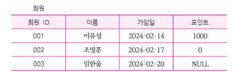

# 2-4. NULL

## 1. NULL의 개념

> **NULL**이란 데이터베이스에서 **값이 존재하지 않거나**, **알 수 없는 값** 또는 **아직 할당되지 않은 값**을 의미하는 특별한 상태이다.

- **NULL은 숫자 `0`이나 공백(`''`)과는 다른 개념**이다.
- **알 수 없는 상태**를 정확히 표현하여 데이터의 무결성을 유지하는 데 중요한 역할을 한다.
- 일반적인 비교 연산자(`=`, `!=` 등)로 비교할 수 없으며, **`IS NULL`**, **`IS NOT NULL`** 을 사용한다.

### 1.1 NULL의 예시

**'회원' 테이블**

| 회원ID | 이름 | 가입일 | 포인트 |
|---|---|---|---|
| 001 | 이유성 | 2024-02-14 | 1000 |
| 002 | 조영훈 | 2024-02-17 | 0 |
| 003 | 임한율 | 2024-02-20 | NULL |

- **`1000`** : 포인트가 1000점
- **`0`** : 포인트가 0점
- **`NULL`** : 포인트 값이 없거나 알 수 없는 상태

> **핵심:** `NULL ≠ 0`이며, `NULL`은 **값이 없는 상태**를 나타낸다.

---

## 2. NULL의 연산

NULL은 연산 대상이 **개별 데이터인지**, **데이터 그룹인지**에 따라 다르게 처리된다.

### 2.1 개별 데이터 연산(산술 연산)

> 산술 연산자(`+`, `-`, `*`, `/`)를 사용하여 계산할 때, **연산에 NULL이 포함되면 결과도 NULL**이 된다.

**예시**

| 연산 | 결과 |
|---|---|
| `100 + 50` | 150 |
| `100 + NULL` | NULL |
| `NULL * 10` | NULL |
| `NULL - 50` | NULL |

- NULL은 **0이 아니므로** 일반적인 숫자처럼 계산할 수 없다.
- 연산에 필요한 값이 NULL이라면 **결과도 NULL**이다.

### 2.2 여러 행 연산(집계 함수)

> **집계 함수(`SUM`, `AVG`, `COUNT` 등)** 는 여러 행의 데이터를 대상으로 통계를 계산하며, 일반적으로 **NULL을 계산 대상에서 제외**한다.

**예시: 회원 포인트**

| 회원ID | 포인트 |
|---|---|
| 001 | 1000 |
| 002 | 0 |
| 003 | NULL |

| 집계 함수 | 결과 | 설명 |
|---|---|---|
| `SUM(포인트)` | 1000 | NULL 제외 후 합계 |
| `AVG(포인트)` | 500 | NULL 제외 후 평균 |
| `COUNT(포인트)` | 2 | NULL이 아닌 값의 개수 |
| `COUNT(*)` | 3 | NULL 여부와 관계없이 전체 행 개수 |

> **시험 포인트**
>
> - **산술 연산:** NULL이 포함되면 결과도 NULL
> - **집계 함수:** 일반적으로 NULL을 제외하고 계산
> - **`COUNT(*)`:** NULL 여부와 관계없이 전체 행의 개수를 계산

---

## 3. 핵심 암기 정리

| 구분 | 핵심 내용 |
|---|---|
| **NULL** | 값이 없거나 알 수 없는 상태 |
| **0과의 차이** | NULL은 0이 아님 |
| **NULL 비교** | `IS NULL`, `IS NOT NULL` |
| **산술 연산** | NULL 포함 시 결과 NULL |
| **집계 함수** | 일반적으로 NULL 제외 |
| **COUNT(*)** | NULL 여부와 관계없이 전체 행 계산 |
