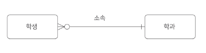
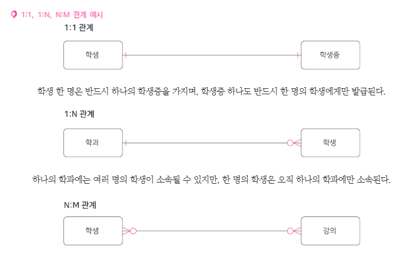
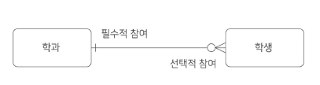

# 1-4. 관계(Relationship)

## 1. 관계의 개념

> **관계(Relationship)** 란 **엔터티와 엔터티 사이의 논리적인 연관성**을 의미한다.

엔터티는 관계를 맺음으로써 **의미 있는 정보**로 확장된다.

예를 들어, **'학생' 엔터티**와 **'강의' 엔터티**가 **'수강한다'** 라는 관계를 맺으면 **어떤 학생이 어떤 강의를 듣는지**와 같은 정보를 표현할 수 있다.

- 엔터티 간의 업무적 연관성을 표현한다.
- 데이터 사이의 연결 구조를 파악할 수 있다.

---

## 2. 관계의 종류

관계는 크게 **존재적 관계**와 **행위적 관계**로 구분한다.

### 2.1 존재적 관계

> **존재적 관계**란 엔터티 간의 **소속이나 포함 관계** 등 존재 상태를 나타내는 관계이다.

**예시**

- 학생은 학과에 **'소속된다'**.
- 학과는 학생을 **'포함한다'**.

### 2.2 행위적 관계

> **행위적 관계**란 엔터티 간에 발생하는 **행위나 사건**을 표현하는 관계이다.

**예시**

- 학생은 강의를 **'수강한다'**.
- 고객은 상품을 **'주문한다'**.

---

## 3. 관계의 표기법

ERD에서 관계는 다음 세 가지 요소를 통해 표현한다.

1. **관계명(Relationship Name)**
2. **관계차수(Cardinality)**
3. **관계선택사양(Optionality)**

### 3.1 관계명

> **관계명**이란 두 엔터티 사이에서 일어나는 **행위나 상태를 동사 형태로 표현한 것**이다.

관계명을 통해 두 엔터티가 **어떤 의미로 연결되는지** 쉽게 파악할 수 있다.

**예시**

- 학생 → 학과: **'소속된다'**
- 학과 → 학생: **'포함한다'**
- 학생 → 강의: **'수강한다'**

---

## 4. 관계차수(Cardinality)

> **관계차수**란 두 엔터티 간의 관계에서 **한 엔터티의 인스턴스가 상대 엔터티의 인스턴스 몇 개와 연결될 수 있는지**를 나타내는 것이다.

대표적인 관계차수는 다음과 같다.

- **1:1 관계**
- **1:N 관계**
- **N:M 관계**

까마귀발 표기법(Crow's Foot Notation)에서는 관계선 끝에 **하나(`|`)** 또는 **여러 개(까마귀발)** 를 의미하는 기호를 붙여 표현한다.

### 4.1 1:1 관계

> **1:1 관계**란 한 엔터티의 인스턴스가 다른 엔터티의 인스턴스 **최대 한 개와 연결되는 관계**이다.

**예시: 학생 - 학생증**

- 학생 한 명은 하나의 학생증을 가진다.
- 학생증 하나는 한 명의 학생에게 발급된다.

### 4.2 1:N 관계

> **1:N 관계**란 한 엔터티의 인스턴스가 상대 엔터티의 **여러 인스턴스와 연결될 수 있는 관계**이다.

**예시: 학과 - 학생**

- 하나의 학과에는 여러 명의 학생이 소속될 수 있다.
- 한 명의 학생은 하나의 학과에만 소속된다.

### 4.3 N:M 관계

> **N:M 관계**란 양쪽 엔터티의 인스턴스가 서로 **여러 인스턴스와 연결될 수 있는 관계**이다.

**예시: 학생 - 강의**

- 한 명의 학생은 여러 강의를 수강할 수 있다.
- 하나의 강의도 여러 학생이 수강할 수 있다.

### 4.4 관계차수 비교

| 관계차수 | 의미 | 예시 |
|---|---|---|
| **1:1** | 하나 ↔ 하나 | 학생 - 학생증 |
| **1:N** | 하나 ↔ 여러 개 | 학과 - 학생 |
| **N:M** | 여러 개 ↔ 여러 개 | 학생 - 강의 |

> **시험 포인트:** 관계형 데이터베이스에서는 **N:M 관계**를 일반적으로 **중간 엔터티(교차 엔터티)** 를 사용하여 두 개의 **1:N 관계**로 변환한다.
>
> 예시: **학생 → 수강신청 ← 강의**

---

## 5. 관계선택사양(Optionality)

> **관계선택사양(Optionality)** 이란 한 엔터티의 인스턴스가 상대 엔터티의 인스턴스와 **반드시 관계를 맺어야 하는지**, 아니면 **관계를 맺지 않아도 되는지**를 나타내는 규칙이다.

관계선택사양은 다음과 같이 구분한다.

- **필수적 참여(Mandatory)**: 반드시 관계를 맺어야 한다.
- **선택적 참여(Optional)**: 관계를 맺지 않아도 된다.

까마귀발 표기법에서는 관계선 끝 안쪽에 다음 기호를 사용한다.

- **`|`** : 필수 참여 (최소 1개)
- **`O`** : 선택적 참여 (최소 0개)

### 5.1 필수적 참여

> **필수적 참여**란 인스턴스가 상대 엔터티의 인스턴스와 **반드시 관계를 맺어야 하는 경우**이다.

**예시**

- 학생은 반드시 하나의 학과에 소속되어야 한다.
- 따라서 학생 입장에서 **'학과'는 필수적 관계**이다.

### 5.2 선택적 참여

> **선택적 참여**란 인스턴스가 상대 엔터티의 인스턴스와 **관계를 맺지 않아도 되는 경우**이다.

**예시**

- 하나의 학과에는 학생이 한 명도 없을 수 있다.
- 따라서 학과 입장에서 **'학생'은 선택적 관계**이다.

### 5.3 관계차수와 선택사양의 조합

까마귀발 표기법에서는 **최소 참여 수**와 **최대 참여 수**를 함께 표현한다.

| 표기 | 최소 참여 | 최대 참여 | 의미 |
|---|---|---|---|
| **O\|** | 0 | 1 | 0개 또는 1개 |
| **\|\|** | 1 | 1 | 반드시 1개 |
| **O<** | 0 | N | 0개 이상 |
| **\|<** | 1 | N | 1개 이상 |

※ `<`는 실제 ERD에서 **까마귀발 모양**으로 표현된다.

> **핵심 구분**
>
> - **관계차수**: 최대 몇 개의 인스턴스와 연결되는가?
> - **관계선택사양**: 반드시 관계를 맺어야 하는가?
>
> 두 개념을 조합하여 관계의 **최소·최대 참여 수**를 표현한다.

---

## 6. 핵심 암기 정리

| 구분 | 핵심 내용 |
|---|---|
| **관계** | 엔터티 사이의 논리적 연관성 |
| **존재적 관계** | 소속, 포함 등의 존재 상태 |
| **행위적 관계** | 주문, 수강 등의 행위나 사건 |
| **관계명** | 엔터티 간 관계를 동사로 표현 |
| **관계차수** | 1:1 / 1:N / N:M |
| **관계선택사양** | 필수적 참여 / 선택적 참여 |

### 시험 핵심 포인트

- **존재적 관계**와 **행위적 관계**의 차이
- **관계차수**는 최대 참여 수를 나타냄
- **관계선택사양**은 최소 참여 수를 나타냄
- **N:M 관계**는 구현 시 교차 엔터티를 통해 분해
- **까마귀발 표기법**에서 `O`는 선택, `|`는 필수, 까마귀발은 다수를 의미

---

## 7. 셀프 테스트

1. **관계(Relationship)** 란 무엇인가?
2. **존재적 관계**와 **행위적 관계**의 차이는?
3. **관계명**은 어떤 형태로 표현하는가?
4. **1:1**, **1:N**, **N:M** 관계의 차이는?
5. **필수적 참여**와 **선택적 참여**의 차이는?
6. **관계차수**와 **관계선택사양**은 각각 무엇을 나타내는가?
7. **N:M 관계**를 실제 데이터베이스에서 어떻게 구현하는가?
